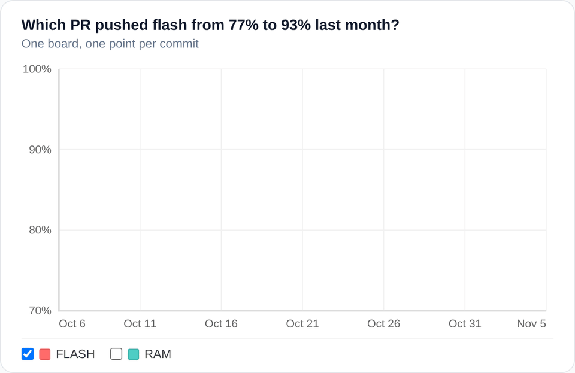
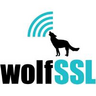

<p align="center">
  
</p>

<h1 align="center">MemBrowse</h1>

<p align="center"><b>No more <code>MEMORY { FLASH, RAM }</code> surprises.</b></p>

<p align="center">
  <a href="https://badge.fury.io/py/membrowse"></a>
  <a href="https://pypi.org/project/membrowse/"></a>
  <a href="https://www.gnu.org/licenses/gpl-3.0"></a>
  <a href="https://pepy.tech/project/membrowse"></a>
  <a href="https://github.com/marketplace/actions/binary-size-memory-footprint-tracking"></a>
  <a href="https://github.com/membrowse/membrowse-action"></a>
</p>

MemBrowse is continuous memory footprint tracking for firmware: flash and RAM on every commit, for every target, with the full history.

A size script or the linker tells you how big today's build is. MemBrowse keeps every build, so when flash climbs you can see which pull request used it, instead of bisecting weeks of commits after the linker fails.

- **Every pull request** gets a comment with the bytes it adds or removes per region, and the symbols that grew.
- **Every target** keeps its history, so "where did the flash go last month?" has an answer.
- **Every product** shows on one screen with how close it is to its limit, and budgets fail CI before a target runs out.

The CLI works locally with no account. [Sign up free](https://membrowse.com/signup) for PR comments, history and budgets.

📖 **Documentation:** [docs.membrowse.com](https://docs.membrowse.com)

<p align="center">
  
</p>

## Firmware teams tracking memory with MemBrowse

<table align="center">
  <tr>
    <td align="center" width="130">
      <a href="https://docs.tinyusb.org"></a><br>TinyUSB
    </td>
    <td align="center" width="130">
      <a href="https://meshtastic.org"></a><br>Meshtastic
    </td>
    <td align="center" width="130">
      <a href="https://nuttx.apache.org"></a><br>Apache NuttX
    </td>
    <td align="center" width="130">
      <a href="https://flipperzero.one"></a><br>Flipper Devices
    </td>
  </tr>
  <tr>
    <td align="center" width="130">
      <a href="https://github.com/ZSWatch/ZSWatch"></a><br>ZSWatch
    </td>
    <td align="center" width="130">
      <a href="https://www.wolfssl.com"></a><br>wolfSSL
    </td>
    <td align="center" width="130">
      <a href="https://www.rt-thread.io"></a><br>RT-Thread
    </td>
    <td align="center" width="130">
      <a href="https://www.adafruit.com"></a><br>Adafruit
    </td>
  </tr>
  <tr>
    <td align="center" width="130">
      <a href="https://github.com/ventZl/cmrx"></a><br>CMRX
    </td>
    <td align="center" width="130">
      <a href="https://github.com/SuperTinyKernel-RTOS"></a><br>SuperTinyKernel
    </td>
    <td align="center" width="130">
      <a href="https://www.wildernesslabs.co"></a><br>Wilderness Labs
    </td>
    <td align="center" width="130">
      <a href="https://rabbitholecomputing.com"></a><br>Rabbit Hole Computing
    </td>
  </tr>
</table>

> "Loving MemBrowse so far. We've been trying to hand-roll solutions to this for far too long, and they just kept breaking."
> — Austin, [Meshtastic](https://membrowse.com/public/meshtastic/firmware)

<p align="center"><a href="https://membrowse.com/showcase">See the public dashboards →</a></p>

## Quick Start

### Analyze your firmware locally (no account required)

```bash
pip install membrowse

membrowse report build/firmware.elf "src/linker.ld"
```

**Example output:**

```
ELF Metadata: build/firmware.elf  |  Arch: ARM  |  Machine: EM_ARM  |  Toolchain: gcc-10.3.1  |  Entry: 0x0802015d  |  Type: ET_EXEC
==========================================================================================================================================================

Region               Address Range                                Size                Used                Free  Utilization
--------------------------------------------------------------------------------------------------------------------------------------------
FLASH                0x08000000-0x08100000             1,048,576 bytes       365,192 bytes       683,384 bytes  [██████░░░░░░░░░░░░░░] 34.8%
  └─ FLASH_START     0x08000000-0x08004000                16,384 bytes        14,708 bytes         1,676 bytes  [█████████████████░░░] 89.8%
     • .isr_vector              392 bytes
     • .isr_extratext        14,316 bytes
  └─ FLASH_TEXT      0x08020000-0x08100000               917,504 bytes       350,484 bytes       567,020 bytes  [███████░░░░░░░░░░░░░] 38.2%
     • .text                350,476 bytes
RAM                  0x20000000-0x20020000               131,072 bytes        26,960 bytes       104,112 bytes  [████░░░░░░░░░░░░░░░░] 20.6%
  • .bss                     8,476 bytes
  • .heap                   16,384 bytes
  • .stack                   2,048 bytes

Top 20 Largest Symbols
======================

Name                                     Address                    Size  Type       Section              Source
--------------------------------------------------------------------------------------------------------------------------------------------
usb_device                               0x20000a30          5,444 bytes  OBJECT     .bss                 usb.c
mp_qstr_const_pool                       0x08062b70          4,692 bytes  OBJECT     .text                qstr.c
mp_execute_bytecode                      0x080392f9          4,208 bytes  FUNC       .text                vm.c
...
```

See the [CLI reference](https://docs.membrowse.com) for JSON output, symbol filtering, uploading and historical onboarding.

### Track memory in CI (GitHub Actions)

Add a workflow that reports each push and comments the diff on pull requests:

```yaml
name: Memory Analysis
on: [push, pull_request]

jobs:
  analyze:
    runs-on: ubuntu-latest
    steps:
      - uses: actions/checkout@v4

      - name: Build firmware
        run: make all # your build commands

      - name: Analyze memory
        uses: membrowse/membrowse-action@v1
        with:
          elf: build/firmware.elf
          ld: "src/linker.ld"
          target_name: stm32f4
          api_key: ${{ secrets.MEMBROWSE_API_KEY }}

      - name: Post PR comment
        if: github.event_name == 'pull_request'
        uses: membrowse/membrowse-action/comment-action@v1
        with:
          api_key: ${{ secrets.MEMBROWSE_API_KEY }}
          commit: ${{ github.event.pull_request.head.sha }}
```

Add your API key as a repository secret named `MEMBROWSE_API_KEY` ([get one free](https://membrowse.com/signup)). The action is [published on the GitHub Marketplace](https://github.com/marketplace/actions/binary-size-memory-footprint-tracking) by a verified creator.

To fill in the history for existing commits, see [onboarding](https://docs.membrowse.com). For budgets, custom comment templates and every action input, see [docs.membrowse.com](https://docs.membrowse.com).

### Track benchmark metrics

Attach benchmark results (cycle counts, timings, scores) to a commit; MemBrowse plots them next to the memory history and compares them between builds. The target must already have a memory report. Uploading a metric again replaces its value, so separate CI jobs can each post their own.

```yaml
      - name: Upload benchmark metrics
        uses: membrowse/membrowse-action/metrics-action@v1
        with:
          target_name: stm32f4
          api_key: ${{ secrets.MEMBROWSE_API_KEY }}
          metrics: |
            Boot time=${{ steps.bench.outputs.boot_ms }} ms
            CoreMark=${{ steps.bench.outputs.coremark }}
          # or: metrics_file: bench.json
```

From any other CI system, or locally:

```bash
membrowse metrics -m "Boot time" "$BOOT_MS" ms -m CoreMark "$SCORE" \
    --target-name stm32f4 --api-key "$MEMBROWSE_API_KEY"

membrowse metrics --file bench.json \
    --target-name stm32f4 --api-key "$MEMBROWSE_API_KEY"
```

`bench.json` is an array of `{"name": "CoreMark", "unit": "score", "value": 389.5}` entries (`unit` is optional), the same array [github-action-benchmark](https://github.com/benchmark-action/github-action-benchmark) takes for custom tools. Run `membrowse metrics --help` for commit selection (`--commit-sha`, `--github`) and removing metrics (`--delete`).

### Set it up with Claude Code

If you use [Claude Code](https://claude.ai/code), the MemBrowse plugin finds your build outputs, checks your linker scripts and writes the workflows:

```
/plugin marketplace add membrowse/membrowse-action
/plugin install membrowse@membrowse-marketplace
/membrowse-integrate
```

## What it reads

MemBrowse reads any ELF file: ARM, RISC-V, Xtensa and more. With DWARF debug info, each symbol is mapped to its source file. Memory regions come from:

- **GNU LD** linker scripts (`*.ld`, `*.cmd`), including `INCLUDE`d sub-scripts
- **IAR EWARM ICF** files (`*.icf`)
- **SEGGER Embedded Studio** project files (`*.emProject`)

Linker map files (GNU LD and IAR) add archive and object file attribution. Format detection is based on content, so file extensions don't have to match.

Is your toolchain or layout file not covered? Email support@membrowse.com.

## Your code stays in CI

- Only the JSON report is uploaded. Source code and binaries stay in your CI.
- The CLI and GitHub Action are open source under GPLv3, so you can read exactly what is sent.
- On-premise deployment runs MemBrowse entirely inside your network. Point the action at it with `api_url`. [Contact us](https://membrowse.com/pricing).

## Documentation & Support

- **Docs**: [docs.membrowse.com](https://docs.membrowse.com)
- **Issues**: https://github.com/membrowse/membrowse-action/issues
- **Support**: support@membrowse.com

## License

GPLv3. See [LICENSE](LICENSE).
